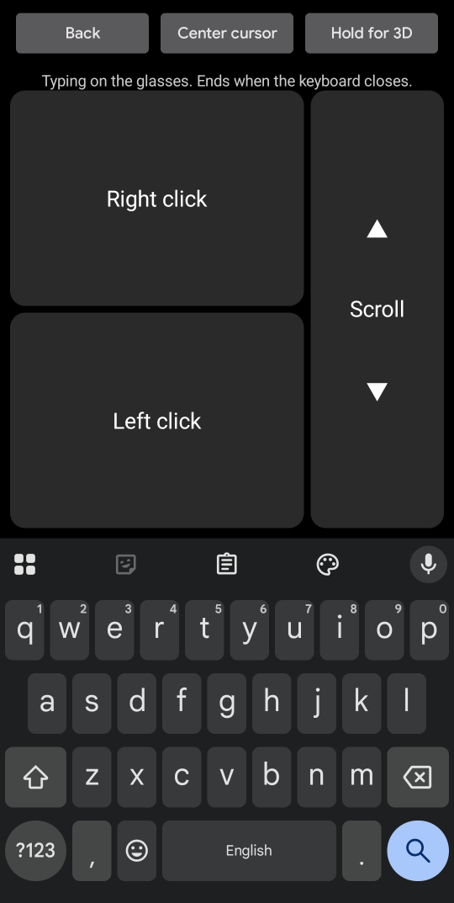

# XR Desk

This android app enables advanced screen stabilization for the XReal XBX A01+ XR glasses as well as pointer based mouse and keyboard control.

> [!NOTE]
> This app was completely vibecoded with Opus 5.5.
>
> I only provided design direction and testing.

## Demos

### Stabilization

### 3DoF Mouse and Keyboard Control

Note that the mouse cursor looks normal in the glasses, but doesn't show up in screen recordings, so enabled some developer tool settings to allow you to see where the mouse would be.

### Screenshots

  
  
  

## Features

- **Stabilization**: the picture stays put when you move your head a little, then drifts back
  to center.
- **Phone as a mouse**: point the top of the phone at the glasses' screen to move the cursor;
  left click, right click, drag and scroll.
- **Phone as a keyboard**: click a text box on the glasses and your phone's keyboard opens,
  typing straight into it, autocorrect included.
- **Picture size and position**: shrink the whole desktop inside the glasses' display or zoom
  in on it, and move it where it's easiest to see.
- **3D videos**: switch the glasses to side-by-side 3D and back from the phone, or with the
  glasses' menu button.

## Requirements

- **XREAL xbx a01 or a01+ glasses**, connected to the phone over USB-C. Stabilization reads
  their motion sensor; other glasses aren't supported yet.
- **An Android phone that drives the glasses as a desktop**, with Android 14 or newer. XR Desk is
  developed and tested on a Pixel 9a with Android 17. It relies on parts of Android that aren't
  official APIs, so other phones and versions may not work.
- **[Shizuku](https://shizuku.rikka.app/)**, which gives XR Desk the extra permissions it needs
  (see below). No root needed.

## Install

1. **Install Shizuku** from [Google Play](https://play.google.com/store/apps/details?id=moe.shizuku.privileged.api)
   or its [GitHub releases](https://github.com/RikkaApps/Shizuku/releases), open it and start it
   with **Wireless debugging** (Shizuku walks you through it; it needs Developer options turned
   on). Start Shizuku again after each reboot of the phone.
2. **Install XR Desk**: download the latest `xrdesk-<version>.apk` from
   [Releases](https://github.com/ermay12/xrdesk/releases/latest) on the phone and open it. Allow
   installing apps from your browser or file manager when asked.
3. **Plug in the glasses and open XR Desk.** Allow XR Desk to
   use Shizuku, to show notifications, and to access the glasses. For the glasses, choose **Always allow**, so you
   aren't asked again each time you plug them in.

Why Shizuku? Moving the glasses' picture, sending mouse input to the glasses and showing their
keyboard on your phone all need permissions that normal apps don't get. Shizuku lets XR Desk use
them through Android's own debugging access, without rooting the phone.

## Use

### Stabilization

- **Start Stabilization** / **Stop Stabilization** turns it on and off; **Recenter** puts the
  picture back in the middle. Both are at the bottom of the screen, just above Mouse. The
  notification has them too.
- Tap **Stabilization settings** to tune it. **Drift back to center** is how long the picture
  takes to come back after you move your head, in seconds; higher is slower. A large number,
  like 400, anchors the picture: it stays put until you recenter. **Max side-to-side
  rotation (yaw)** and **Max up-and-down rotation (pitch)** are how far it compensates in each
  direction before following you.
- **Drift back curve**: _Speed up_ (the default) accelerates then stops suddenly, _Smooth_ eases
  in and out, _Exponential_ is fastest at first, and _Linear_ moves at a constant speed.

### The glasses' buttons

Once you open XR Desk, the glasses send their button presses to it instead of handling them, so
their own menu doesn't open. The **menu button** switches between 2D and 3D (see
[3D videos](#3d-videos)); the **volume buttons** change the phone's media volume, and repeat
while held. This works whether or not you're stabilizing.

XR Desk keeps running, with its notification, until you unplug the glasses; that's when they get
their buttons back. Open XR Desk again after plugging them back in.

### Picture size and position

- Tap **Picture size and position** and watch the glasses while you adjust. Drag up and down
  on **Size** to resize the whole desktop: down to 50%, with a black border around it, or up to
  200%, which zooms in and cuts off its edges. Drag on **Move** to move it side to side or up and
  down, even partly off the display (or, zoomed in, to see its edges). Only how far you drag
  counts, not where you touch, and the phone ticks every 5% and clicks at the center and at 100%,
  so you can do it without looking.
- **Center picture** puts it back in the middle; **Full size** sets it back to 100%. Leave with
  **Back** at the top. Recenter and the drift back go to the position you set.
- They apply whether stabilizing or not: while either is changed, XR Desk keeps running after
  Stop Stabilization, with its notification.
- With a smaller picture, stabilization slides it into the border instead of cutting off its
  edges. A smaller picture also uses fewer of the glasses' pixels, so small text gets a little
  softer.

### Mouse

Tap **Mouse**, the big button at the bottom of the screen, easy to find with your thumb while
wearing the glasses. It works with or without stabilization.

- **Point** with the top edge of the phone. **Center cursor** puts the cursor back in the middle.
  To recenter the stabilized picture, use Recenter on the main screen or in the notification.
- **Hold for 3D** (top right) switches the glasses to 3D, and **Hold for 2D** back; hold it for
  half a second. See [3D videos](#3d-videos).
- After a click, the window you clicked keeps input focus while you use the mouse screen, and
  the phone's volume buttons change the volume as usual.
- **Right click** and **Left click** are at the bottom left; hold Left click and turn the phone
  to drag. The cursor holds still while you press, so a tap doesn't become a drag.
- **Scroll** by dragging up and down on the scroll strip: drag down to scroll down, like a scroll
  bar, or switch on **Reverse scroll direction** to drag the page like a touch screen.
- The two **Mouse speed** sliders set how far the cursor moves when you turn the phone side to
  side and when you tilt it up and down; **Scroll speed** sets how far a drag scrolls.
- Leave with the **Back** button at the top. (The phone's own Back gesture doesn't leave the
  mouse screen, so you can't leave by accident.)

### Typing

On the mouse screen, click a text box on the glasses and your phone's keyboard opens, with a short
buzz so you know without looking; type as usual. The buttons fill the space above the keyboard,
and typing ends by itself when the keyboard closes (or press Back). After closing the keyboard,
click the text box again to bring it back.

### 3D videos

The glasses can show side-by-side (SBS) 3D: the left half of the picture goes to your left eye
and the right half to your right eye. The whole desktop is split the same way, so it's hard to
use in 3D; find and start the video in 2D first.

1. Open the video and make it fullscreen, using the mouse screen.
2. Switch to 3D: tap **Switch to 3D** on the main screen, hold **Hold for 3D** on the mouse
   screen for half a second, or press the glasses' menu button. The glasses go dark for a few
   seconds, then the phone buzzes twice.
3. Pause and seek with the phone's media controls (in the notification shade), or with the
   mouse screen. The cursor shows in one eye at a time: it starts in your left eye's view, and
   moved past that view's right edge it carries on in your right eye's view, from its left edge.
   Leave the mouse screen to hide it.
4. Switch back to 2D the same ways, or with **Switch to 2D** in XR Desk's notification.

In 3D, stabilization only corrects up-and-down head movement, and the picture is full size and
centered: moving or resizing it sideways would put parts of the picture in the wrong eye. Your
picture size and position come back in 2D. The glasses are always in 2D after being plugged in.

Without XR Desk, avoid the 3D item in the glasses' own menu: on phones that can only send
half-width 3D (like the Pixel 9a), it switches to full-width 3D, and the picture is lost until
you unplug the glasses.

## Known limits

- Only XREAL xbx a01 and a01+ glasses are supported.
- Phone updates may break XR Desk, since it uses parts of Android that aren't public APIs.
- While the mouse screen is open, the glasses' keyboard appears on the phone.
- Once XR Desk is open, the glasses' own menu (brightness and so on) isn't available until you
  unplug them (see [The glasses' buttons](#the-glasses-buttons)).
- 3D is half-width side by side (each eye sees 960 × 1080 pixels, stretched).

## Building from source

See [BUILDING.md](BUILDING.md) for building, the developer workflow and how XR Desk works inside.

## License

XR Desk is free software under the [GNU General Public License v3.0](LICENSE) or later: you can
use, study, change and share it, and if you distribute a changed version, you must share its
source under the same license. The APK includes the
[Shizuku API library](https://github.com/RikkaApps/Shizuku-API) (Apache License 2.0).
