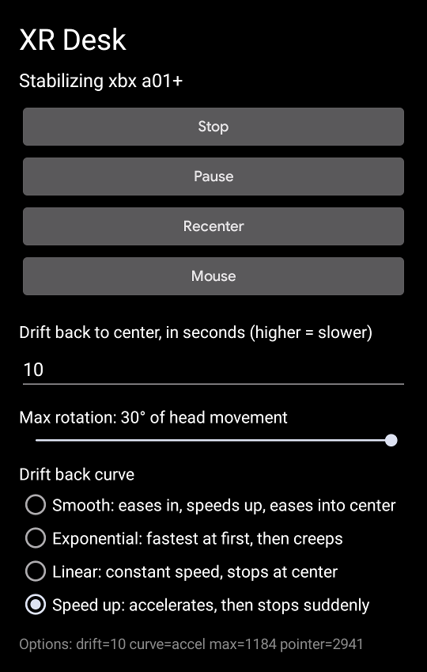
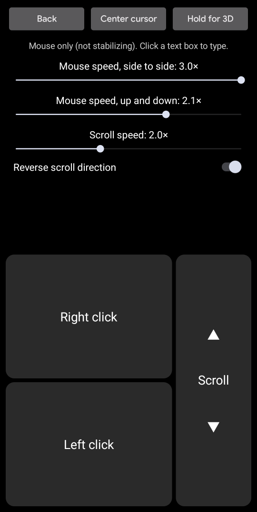

# XR Desk

This android app enables advanced screen stabilization for the XReal XBX A01+ XR glasses as well as pointer based mouse and keyboard control.

> [!NOTE]
> This app was completely vibecoded by Opus 5.5.
>
> I only provided design direction and testing.

## Demos

### Stabilization

### 3DoF Mouse and Keyboard Control

Note that the mouse cursor looks normal in the glasses, but doesn't show up in screen recordings, so enabled some developer tool settings to allow you to see where the mouse would be.

### Screenshots

## Features

- **Stabilization**: the picture stays put when you move your head a little, then drifts back
  to center.
- **Phone as a mouse**: point the top of the phone at the glasses' screen to move the cursor;
  left click, right click, drag and scroll.
- **Phone as a keyboard**: click a text box on the glasses and your phone's keyboard opens,
  typing straight into it, autocorrect included.

## Requirements

- **XREAL xbx a01 or a01+ glasses**, connected to the phone over USB-C. Stabilization reads
  their motion sensor; other glasses aren't supported yet.
- **An Android phone that drives the glasses as a desktop**, with Android 14 or newer. XR Desk is
  developed and tested on a Pixel 9a with Android 17. It relies on parts of Android that aren't
  official APIs, so other phones and versions may not work.
- **[Shizuku](https://shizuku.rikka.app/)**, which gives XR Desk the extra permissions it needs
  (see below). No root needed.

## Install

1. **Install Shizuku** from [Google Play](https://play.google.com/store/apps/details?id=moe.shizuku.privileged.api)
   or its [GitHub releases](https://github.com/RikkaApps/Shizuku/releases), open it and start it
   with **Wireless debugging** (Shizuku walks you through it; it needs Developer options turned
   on). Start Shizuku again after each reboot of the phone.
2. **Install XR Desk**: download the latest `xrdesk-<version>.apk` from
   [Releases](https://github.com/ermay12/xrdesk/releases/latest) on the phone and open it. Allow
   installing apps from your browser or file manager when asked.
3. **Plug in the glasses, open XR Desk and tap Start.** Allow XR Desk to use Shizuku, to show
   notifications, and to access the glasses. For the glasses, choose **Always allow**, so you
   aren't asked again each time you plug them in.

Why Shizuku? Moving the glasses' picture, sending mouse input to the glasses and showing their
keyboard on your phone all need permissions that normal apps don't get. Shizuku lets XR Desk use
them through Android's own debugging access, without rooting the phone.

## Use

### Stabilization

- **Start / Stop** turns stabilization on and off. **Pause** keeps XR Desk running but leaves the
  picture still; **Recenter** puts it back in the middle. The notification has the same buttons.
- **Drift back to center** is how long the picture takes to come back after you move your head,
  in seconds; higher is slower. **Max rotation** is how far it compensates before following you.
- **Drift back curve**: _Smooth_ eases in and out, _Exponential_ is fastest at first,
  _Linear_ moves at a constant speed, and _Speed up_ accelerates then stops suddenly.
- XR Desk stops when you unplug the glasses; tap Start again after plugging them back in.

### Mouse

Tap **Mouse**. It works with or without stabilization.

- **Point** with the top edge of the phone. **Volume down** or **Center cursor** puts the cursor
  back in the middle; **Center screen** recenters the stabilized picture.
- **Right click** and **Left click** are at the bottom left; hold Left click and turn the phone
  to drag. The cursor holds still while you press, so a tap doesn't become a drag.
- **Scroll** by dragging up and down on the scroll strip. **Mouse speed** sets how far the
  cursor moves when you turn the phone.
- Leave with the **Back** button at the top. (The phone's own Back gesture only closes the
  keyboard here, so you can't leave by accident.)

### Typing

On the mouse screen, click a text box on the glasses and your phone's keyboard opens; type as
usual. The buttons move up above the keyboard, and typing ends by itself when the keyboard closes
(or press Back). After closing the keyboard, click the text box again to bring it back. **Type**
starts typing by hand, for apps that don't open the keyboard themselves.

## Known limits

- Only XREAL xbx a01 and a01+ glasses are supported.
- Phone updates may break XR Desk, since it uses parts of Android that aren't public APIs.
- While the mouse screen is open, the glasses' keyboard appears on the phone.

## Building from source

See [BUILDING.md](BUILDING.md) for building, the developer workflow and how XR Desk works inside.

## License

XR Desk is free software under the [GNU General Public License v3.0](LICENSE) or later: you can
use, study, change and share it, and if you distribute a changed version, you must share its
source under the same license. The APK includes the
[Shizuku API library](https://github.com/RikkaApps/Shizuku-API) (Apache License 2.0).
